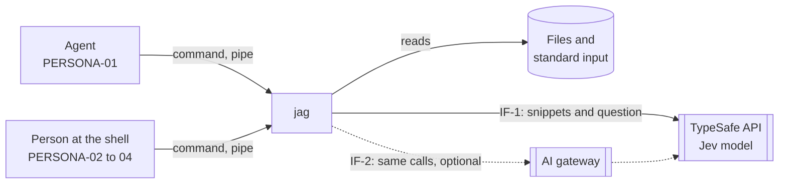

# jag system design

## Design map

Destination: one command-line program that finds the lines that match a term,
ranks them by a question with the Jev model, and returns the best lines within
a size limit and a cost limit.

Frontier: strategy. Building blocks, data, contracts, conventions, and
deployment wait for it.

Fog:

- strategy-1 (strategy, research done, now open): the default count of
  results to score, and the count of model calls in parallel. Facts:
  - One Jev call can score many snippets. More snippets in one call add
    little time (docs.typesafe.ai, api.md and patterns/fan-out.md).
  - The price is $0.042 for each 1M input tokens. Output tokens are free.
    One request holds at most 64k tokens (docs.typesafe.ai, models.md).
  - The rate limits are 100K tokens and 80 requests each second. Over a
    limit, the service gives HTTP 429 (models.md).
  - The earlier implementation scored 200 snippets, 32 in each call, with
    6 calls in parallel. It waited 30 s for one call and retried 4 times.
  - For 200 snippets: about $0.009 in the worst case and $0.002 in a typical
    case. A typical search takes about 1 s of model time. This is an
    estimate: no source gives the time of one call with 32 snippets.

Out of scope:

- A search index. Each search reads the files as they are (SCOPE-06).
- A store of scores between searches (DECISION-46).
- A server, an account, and telemetry (SCOPE-09).
- A local model. Release 1 needs the model service (DECISION-02).

## Quality scenarios

### QS-1: The top results answer the question

- Source: an agent or a person.
- Stimulus: a term and a question, on a folder that holds the answer.
- Environment: normal operation, with the default limits.
- Artifact: the ranking of jag.
- Response: jag returns the matches ranked by how well they answer the
  question.
- Response measure: ndcg@10 of 0.70 or more on the held-out set.
- Importance: H. Risk: H, because the held-out run is not done and the
  scoring prompt is not final.
- Cites: METRIC-01.

### QS-2: jag says when nothing answers

- Source: an agent.
- Stimulus: a question that no line of the folder answers.
- Environment: normal operation.
- Artifact: the ranking and the exit code.
- Response: jag shows the best results with the "no good answer" label and
  exits with code 1.
- Response measure: a decoy AUC of 0.85 or more.
- Importance: H. Risk: M, because the earlier measure is close to the target.
- Cites: METRIC-07.

### QS-3: A typical search is fast

- Source: a person at the shell.
- Stimulus: one typical search.
- Environment: a medium code repository, the default cost limit, and a model
  service that works.
- Artifact: the full search, from the start of the command to the last line.
- Response: jag returns the ranked results.
- Response measure: under 5 seconds.
- Importance: H. Risk: M, because the time of one model call with 32 snippets
  and the time of the file search are estimates, not measurements.
- Cites: METRIC-03, CONSTRAINT-06.

### QS-4: jag fails clearly and fast when the model service is down

- Source: an agent.
- Stimulus: the model service does not answer during a search.
- Environment: a search with a question.
- Artifact: the model client and the exit code.
- Response: jag fails the full search with no partial result. It gives the
  cause and the fix, and exits with the code of the cause.
- Response measure: within 10 seconds of the first call, with the one retry
  included.
- Importance: H. Risk: M, because a long timeout or many retries break the
  target.
- Cites: CONSTRAINT-07, CONSTRAINT-04.

### QS-5: The key stays secret

- Source: any run of jag.
- Stimulus: a message, an error, a notice, or structured output.
- Environment: every mode, including a failure.
- Artifact: the key store and every output path.
- Response: the key never appears in the output. jag refuses a key file that
  other users on the machine can read.
- Response measure: zero outputs that hold the key, in a test of every error
  path.
- Importance: H. Risk: L, because one module owns the key.
- Cites: CONSTRAINT-02.

METRIC-02, METRIC-04, METRIC-05, METRIC-06, and CONSTRAINT-05 have no
scenario. They stay as guards through their pages.

## Context

jag runs on the machine of the user, as one command. It reads the files of a
folder or the text of a pipe. It sends snippets and the question to one
outside service, and it writes the results to the agent or the person that
called it. jag calls no outside search program: its own code finds the
matches (context-3).

- IF-1: jag to the TypeSafe API. Outbound HTTPS calls that score snippets
  with the Jev model. The default route (context-2). Owner: TypeSafe.
- IF-2: jag to an AI gateway. The same calls as IF-1, through a gateway that
  the user names with two settings: the base URL and the model name. Optional
  (CONSTRAINT-03). Owner: the gateway provider.
