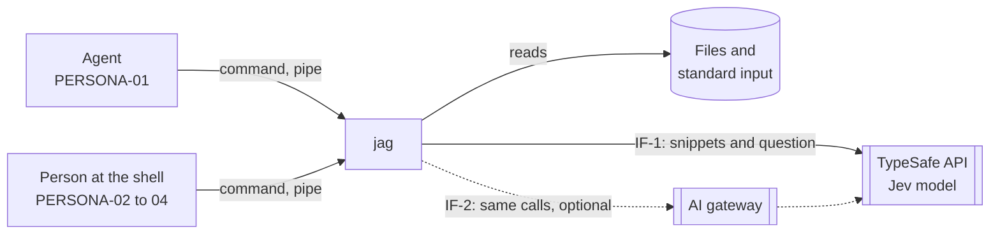
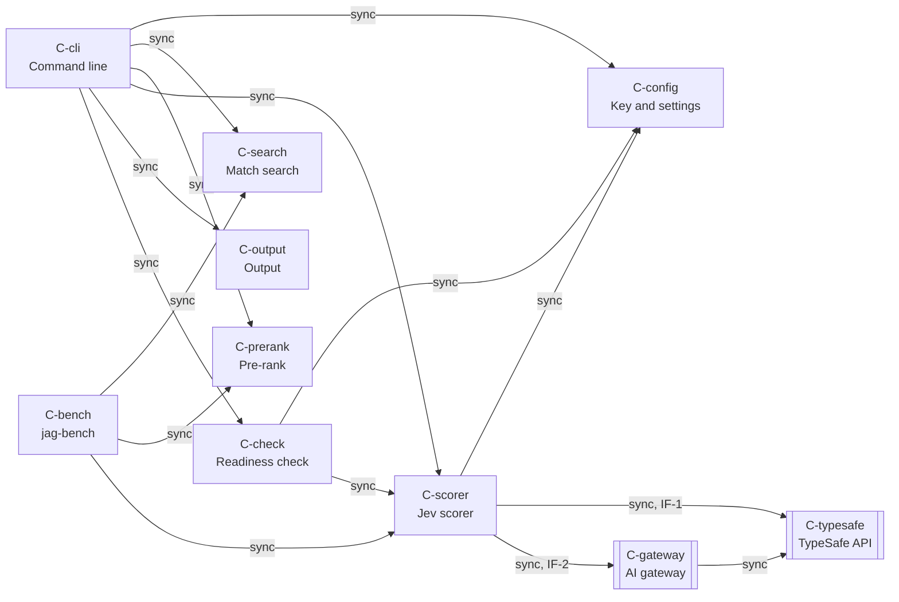

# jag system design

## Design map

Destination: one command-line program that finds the lines that match a term,
ranks them by a question with the Jev model, and returns the best lines within
a size limit and a cost limit.

Frontier: data, contracts, and conventions. Deployment waits for them.

Fog:

- strategy-1 (strategy, research done, settled): the default count of
  results to score, and the count of model calls in parallel. Facts:
  - One Jev call can score many snippets. More snippets in one call add
    little time (docs.typesafe.ai, api.md and patterns/fan-out.md).
  - The price is $0.042 for each 1M input tokens. Output tokens are free.
    One request holds at most 64k tokens (docs.typesafe.ai, models.md).
  - The rate limits are 100K tokens and 80 requests each second. Over a
    limit, the service gives HTTP 429 (models.md).
  - The earlier implementation scored 200 snippets, 32 in each call, with
    6 calls in parallel. It waited 30 s for one call and retried 4 times.
  - For 200 snippets: about $0.009 in the worst case and $0.002 in a typical
    case. A typical search takes about 1 s of model time. This is an
    estimate: no source gives the time of one call with 32 snippets.

Out of scope:

- A search index. Each search reads the files as they are (SCOPE-06).
- A store of scores between searches (DECISION-46).
- A server, an account, and telemetry (SCOPE-09).
- A local model. Release 1 needs the model service (DECISION-02).

## Quality scenarios

### QS-1: The top results answer the question

- Source: an agent or a person.
- Stimulus: a term and a question, on a folder that holds the answer.
- Environment: normal operation, with the default limits.
- Artifact: the ranking of jag.
- Response: jag returns the matches ranked by how well they answer the
  question.
- Response measure: ndcg@10 of 0.70 or more on the held-out set.
- Importance: H. Risk: H, because the held-out run is not done and the
  scoring prompt is not final.
- Cites: METRIC-01.

### QS-2: jag says when nothing answers

- Source: an agent.
- Stimulus: a question that no line of the folder answers.
- Environment: normal operation.
- Artifact: the ranking and the exit code.
- Response: jag shows the best results with the "no good answer" label and
  exits with code 1.
- Response measure: a decoy AUC of 0.85 or more.
- Importance: H. Risk: M, because the earlier measure is close to the target.
- Cites: METRIC-07.

### QS-3: A typical search is fast

- Source: a person at the shell.
- Stimulus: one typical search.
- Environment: a medium code repository, the default cost limit, and a model
  service that works.
- Artifact: the full search, from the start of the command to the last line.
- Response: jag returns the ranked results.
- Response measure: under 5 seconds.
- Importance: H. Risk: M, because the time of one model call with 32 snippets
  and the time of the file search are estimates, not measurements.
- Cites: METRIC-03, CONSTRAINT-06.

### QS-4: jag fails clearly and fast when the model service is down

- Source: an agent.
- Stimulus: the model service does not answer during a search.
- Environment: a search with a question.
- Artifact: the model client and the exit code.
- Response: jag fails the full search with no partial result. It gives the
  cause and the fix, and exits with the code of the cause.
- Response measure: within 10 seconds of the first call, with the one retry
  included.
- Importance: H. Risk: M, because a long timeout or many retries break the
  target.
- Cites: CONSTRAINT-07, CONSTRAINT-04.

### QS-5: The key stays secret

- Source: any run of jag.
- Stimulus: a message, an error, a notice, or structured output.
- Environment: every mode, including a failure.
- Artifact: the key store and every output path.
- Response: the key never appears in the output. jag refuses a key file that
  other users on the machine can read.
- Response measure: zero outputs that hold the key, in a test of every error
  path.
- Importance: H. Risk: L, because one module owns the key.
- Cites: CONSTRAINT-02.

METRIC-02, METRIC-04, METRIC-05, METRIC-06, and CONSTRAINT-05 have no
scenario. They stay as guards through their pages.

## Context

jag runs on the machine of the user, as one command. It reads the files of a
folder or the text of a pipe. It sends snippets and the question to one
outside service, and it writes the results to the agent or the person that
called it. jag uses the ripgrep libraries to find the matches (context-3).
They are part of the jag binary (building-blocks-1), so jag starts no other
program and the user installs one binary.



- IF-1: jag to the TypeSafe API. Outbound HTTPS calls that score snippets
  with the Jev model. The default route (context-2). Owner: TypeSafe.
- IF-2: jag to an AI gateway. The same calls as IF-1, through a gateway that
  the user names with two settings: the base URL and the model name. Optional
  (CONSTRAINT-03). Owner: the gateway provider.

## Solution strategy

| Quality goal | Approach | ADR |
|---|---|---|
| QS-1 answer quality | The ripgrep libraries find the matches. BM25 on the question words pre-ranks them (strategy-5). Jev scores the top 200 (strategy-1). One built-in scoring prompt for each release carries a version id, and structured output names it (strategy-3). | strategy-1, strategy-3 |
| QS-2 no good answer | A fixed threshold on the top Jev probability. The threshold is tuned with the prompt on the development set and changes only with a new prompt version (strategy-2). | strategy-2 |
| QS-3 speed | The ripgrep libraries search in one pass, in the jag process. Jev gets 32 snippets in each call and 6 calls in parallel, so a typical search needs two rounds of calls (strategy-1). | strategy-1 |
| QS-3 and METRIC-05 cost | The default cost limit is 200 results. 200 results cost about $0.009 in the worst case (strategy-1). | strategy-1 |
| QS-4 fail clearly | No fallback to a word-match ranking (DECISION-01). A model failure fails the full search (DECISION-06). The retry rule is in Crosscutting conventions. | DECISION-01 |
| QS-5 key secrecy | One component reads the key, and no other component gets the key as text (Crosscutting conventions). | |

## Building blocks

jag is one Rust program with two commands: `jag` and `jag-bench`
(building-blocks-1, building-blocks-3). Each step of a search is one
component with its own tests (building-blocks-2).

```yaml
components:
  - id: C-cli
    name: Command line
    kind: cli
    summary: Reads the command and the grep options, picks text or structured mode, runs the pipeline, and sets the exit code.
    owns_entities: []
    depends_on:
      - id: C-config
        style: sync
      - id: C-search
        style: sync
      - id: C-prerank
        style: sync
      - id: C-scorer
        style: sync
      - id: C-output
        style: sync
      - id: C-check
        style: sync
    governed_by: []
    realizes: [CAPABILITY-05, CAPABILITY-06]
    areas: [building-blocks, contracts, conventions]
  - id: C-config
    name: Key and settings
    kind: library
    summary: Finds the key and the settings, checks the mode of the key file, and stores or removes the key. The one component that reads the key.
    owns_entities: [ApiKey, Settings]
    depends_on: []
    governed_by: []
    realizes: [CAPABILITY-01, QS-5]
    areas: [building-blocks, data, conventions]
  - id: C-search
    name: Match search
    kind: library
    summary: Uses the ripgrep libraries to find the matches of the term in the files or the piped text, skips noise files, and joins near matches into results with their lines around them.
    owns_entities: [Result]
    depends_on: []
    governed_by: []
    realizes: [CAPABILITY-02, CAPABILITY-03, CAPABILITY-06]
    areas: [building-blocks, contracts]
  - id: C-prerank
    name: Pre-rank
    kind: library
    summary: Orders the results by BM25 on the question words, so the scorer gets the best 200.
    owns_entities: []
    depends_on: []
    governed_by: []
    realizes: [CAPABILITY-02, QS-1, QS-3]
    areas: [building-blocks, strategy]
  - id: C-scorer
    name: Jev scorer
    kind: library
    summary: Sends the results to Jev in calls of 32, with 6 calls in parallel, under the cost limit. Owns the scoring prompt, the retry, the no-good-answer threshold, and the cost count.
    owns_entities: [Score, Cost]
    depends_on:
      - id: C-config
        style: sync
      - id: C-typesafe
        style: sync
        contract: IF-1
      - id: C-gateway
        style: sync
        contract: IF-2
    governed_by: []
    realizes: [CAPABILITY-02, CAPABILITY-07, QS-1, QS-2, QS-3, QS-4]
    areas: [building-blocks, strategy, contracts, conventions]
  - id: C-output
    name: Output
    kind: library
    summary: Writes the ranked results as text or as structured output, applies the size limit, and writes the notices and the cost line.
    owns_entities: []
    depends_on: []
    governed_by: []
    realizes: [CAPABILITY-03, CAPABILITY-04, CAPABILITY-05, CAPABILITY-07]
    areas: [building-blocks, contracts, conventions]
  - id: C-check
    name: Readiness check
    kind: library
    summary: Runs the five checks of DECISION-04 with one free call, and gives the exit code of the first cause that fails.
    owns_entities: []
    depends_on:
      - id: C-config
        style: sync
      - id: C-scorer
        style: sync
    governed_by: []
    realizes: [CAPABILITY-01]
    areas: [building-blocks, conventions]
  - id: C-bench
    name: jag-bench
    kind: cli
    summary: Runs a set of questions with their expected answers through jag and through plain grep, and reports which one finds the answer more often.
    owns_entities: []
    depends_on:
      - id: C-search
        style: sync
      - id: C-prerank
        style: sync
      - id: C-scorer
        style: sync
    governed_by: []
    realizes: [CAPABILITY-12, QS-1, QS-2]
    areas: [building-blocks, deployment]
  - id: C-typesafe
    name: TypeSafe API
    kind: external
    summary: Scores snippets with the Jev model and reports the billed usage.
    owns_entities: []
    depends_on: []
    governed_by: []
    realizes: []
    areas: [context, contracts]
  - id: C-gateway
    name: AI gateway
    kind: external
    summary: An optional route to the TypeSafe API, with the same calls.
    owns_entities: []
    depends_on:
      - id: C-typesafe
        style: sync
    governed_by: []
    realizes: []
    areas: [context, contracts]
```



## Data and ownership

jag keeps no data between searches (data-2, DECISION-46) and builds no index
(SCOPE-06). The only stored data is the key.

| Entity | Owner | Store |
|---|---|---|
| ApiKey | C-config | The first of `JAG_TYPESAFE_API_KEY`, `TYPESAFE_API_KEY`, and `config.api-key` in `~/.config/jag/config.yml` (data-1, DECISION-03). The file has mode 600 or stricter (CV-6). |
| Settings | C-config | Options and variables only. Other settings in the config file wait (DF-1). |
| Result | C-search | Memory, for one search. |
| Score, Cost | C-scorer | Memory, for one search. |

## Contracts

| ID | Provider | Consumer | Mechanism | Versioning rule |
|---|---|---|---|---|
| IF-1 | C-typesafe | C-scorer | HTTPS `POST /v1/systemone` with a Bearer key. One call holds the question and 32 snippets. The response gives the probabilities and the billed usage. | Each jag release pins the Jev model version that its prompt and threshold were tuned on. A setting can name another model (contracts-5). |
| IF-2 | C-gateway | C-scorer | The same calls as IF-1, to the base URL that a setting names. | The same as IF-1. The user sets the model name for the gateway. |
| IF-3 | C-cli | Agent, person | The command line: `jag TERM "QUESTION" [PATH...]` (DECISION-31) with the grep options of DECISION-34. The options `--setup`, `--check`, and `--forget-key` run the setup, the readiness check, and the key removal (contracts-2). | Semantic versions of jag. A removed or changed option needs a new major version. |
| IF-4 | C-cli | Agent, script | Exit codes: 0 results found, 1 no match or no good answer, 2 usage error, 3 key missing, 4 key not accepted, 5 no credit, 6 service down, 7 cost limit reached, 8 results left out by the size limit, 130 stopped with Ctrl-C (contracts-3). DECISION-13 and DECISION-47 give the order when two apply. | A code never changes its meaning in one major version. |
| IF-5 | C-output | Agent | Structured output: one JSON document on standard output, with `version`, `prompt_version`, `results`, and the summary fields of DECISION-28. An error is a JSON document of the same form (DECISION-07, CV-1). An output that does not parse means that jag stopped (contracts-4, DECISION-30). | `version` is the version of the form. In one major version, fields are only added (CONSTRAINT-05). |
| IF-6 | C-search | C-prerank, C-scorer, C-output | The `Result` record in memory: path, first and last line, the lines, the marks on matching lines and on cut lines. | Internal. It changes with the code. |

## Risks

- RK-1: The term can match other lines than in grep. DECISION-33 says that
  the term is a regular expression as in grep, but the ripgrep libraries use
  the pattern rules of `rg`. A default grep pattern treats `+`, `?`, and `|`
  as plain characters, and `rg` does not. `rg` also has no back-references. Test: the
  same term with `grep` and with jag on one folder gives other match lines.
  Mitigation: the README states the pattern rules of `rg`. Open acceptance:
  DECISION-33 changes to "a regular expression as in ripgrep", or jag
  translates the grep form.

## Deferred

- DF-1: Settings other than the key in the config file (data-3). Reason:
  options and variables cover release 1, and no Feature needs a saved
  default. Trigger: a user asks for a default that they can save.
- DF-2: A debug log (conventions-8). Reason: jag has no telemetry and no log
  file, and the error message gives the cause and the fix. Trigger: the first
  setup-failure issue that the message does not explain.
