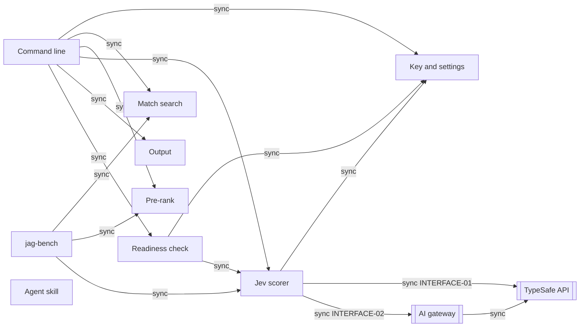
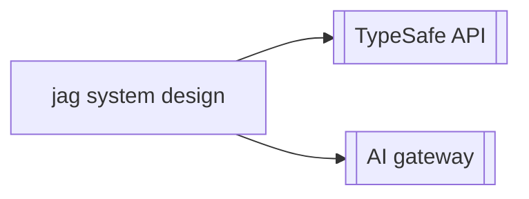

# jag system design

## Summary

jag is one Rust binary that runs on the machine of the user. It finds the
lines that match a term with the ripgrep libraries, pre-ranks them with BM25
on the question words, and scores the top 200 with the Jev model of the
TypeSafe API. It writes the best results as text or as one JSON document,
within a size limit. jag keeps no data between searches and has no server.

The quality priorities, in order:

1. The top results answer the question (QS-1).
2. jag says when nothing answers (QS-2).
3. A typical search is fast (QS-3).
4. jag fails clearly and fast when the model service is down (QS-4).
5. The key stays secret (QS-5).

Key decisions:

- Find the matches with the ripgrep libraries, because they are fast and
  their skip rules are the skip rules of rg (0001-find-matches-with-the-ripgrep-libraries.md).
- Score 200 results in calls of 32, six calls in parallel, because that keeps
  a search near $0.009 at worst and near 1 second of model time
  (0002-score-the-top-200-results-in-calls-of-32-six-calls-in.md).
- Label "no good answer" with a fixed threshold, because one value is easy to
  tune and test (0003-decide-no-good-answer-with-a-fixed-threshold-on-the-top.md).
- Ship one versioned prompt and pin the Jev model in each release, because
  the quality numbers then stay true for a release (0004-ship-one-scoring-prompt-with-a-version-id-in-each-release.md,
  0009-pin-the-jev-model-version-in-each-release.md).
- Build one Rust binary, and ship it on GitHub Releases, crates.io, and
  npm, because it starts fast, installs with no runtime, and agent setups
  already use npm (0005-build-jag-as-one-rust-binary.md,
  0010-ship-jag-on-github-releases-crates-io-and-npm.md).
- Keep the command line, the exit codes, and the JSON form stable, because
  agents and scripts depend on them (0006-run-setup-the-readiness-check-and-key-removal-as-options.md, 0007-number-the-exit-codes-above-2-from-3-to-8.md,
  0008-write-structured-output-as-one-json-document.md).

<!-- SD:DESIGN-MAP:START (generated, do not edit) -->

## Design map

Destination: not stated

### Frontier

- none

### Fog

- none

### Out of scope

- none

<!-- SD:DESIGN-MAP:END -->

<!-- SD:DECISION-INDEX:START (generated, do not edit) -->

## Decision index

| Row key | ADR | Area | What it binds | Source |
|---|---|---|---|---|
| quality-1 |  | quality | The quality scenarios, their ranking, and their ratings | human:404pilo, 2026-10-12 |
| quality-2 | [adr:/0021-check-rg-parity-with-a-cargo-test-that-runs-a-pinned-rg-and.md](../adr/0021-check-rg-parity-with-a-cargo-test-that-runs-a-pinned-rg-and.md) | quality | How the rg parity e2e tests run: the cases, the fixtures, the pinned rg, and the three modes | adr |
| quality-3 | [adr:/0023-run-the-rg-parity-cases-that-git-cannot-store-as-rust-code.md](../adr/0023-run-the-rg-parity-cases-that-git-cannot-store-as-rust-code.md) | quality | The rg parity cases that git cannot store, as Rust code in a second test | adr |
| context-1 |  | context | The outside service that scores the matches: TypeSafe API, Jev model | human:404pilo, 2026-10-12 |
| context-2 |  | context | The route to the model service: direct API, or an AI gateway too | human:404pilo, 2026-10-12 |
| context-3 | [adr:/0001-find-matches-with-the-ripgrep-libraries.md](../adr/0001-find-matches-with-the-ripgrep-libraries.md) | context | How jag finds the matching lines: its own search code, or an outside program such as `ag` | adr |
| strategy-1 | [adr:/0002-score-the-top-200-results-in-calls-of-32-six-calls-in.md](../adr/0002-score-the-top-200-results-in-calls-of-32-six-calls-in.md) | strategy | The default count of results to score, and the count of model calls in parallel | adr |
| strategy-2 | [adr:/0003-decide-no-good-answer-with-a-fixed-threshold-on-the-top.md](../adr/0003-decide-no-good-answer-with-a-fixed-threshold-on-the-top.md) | strategy | How jag decides that no result answers well | adr |
| strategy-3 | [adr:/0004-ship-one-scoring-prompt-with-a-version-id-in-each-release.md](../adr/0004-ship-one-scoring-prompt-with-a-version-id-in-each-release.md) | strategy | How jag holds the scoring prompt, and how it gives a version to the prompt | adr |
| strategy-4 |  | strategy | No fallback when the model is not available | human:404pilo, 2026-10-12 |
| strategy-5 |  | strategy | How jag pre-ranks the matches before it scores them | human:404pilo, 2026-10-12 |
| building-blocks-1 | [adr:/0005-build-jag-as-one-rust-binary.md](../adr/0005-build-jag-as-one-rust-binary.md) | building-blocks | The language and the runtime of jag | adr |
| building-blocks-2 | [adr:/0011-build-jag-as-one-cargo-package-with-one-module-per-component.md](../adr/0011-build-jag-as-one-cargo-package-with-one-module-per-component.md) | building-blocks | The components inside the jag program | adr |
| building-blocks-3 |  | building-blocks | Where the tool lives that measures jag on your own questions | human:404pilo, 2026-10-12 |
| building-blocks-4 | [adr:/0012-use-clap-serde-saphyr-and-rpassword-as-the-outside-crates.md](../adr/0012-use-clap-serde-saphyr-and-rpassword-as-the-outside-crates.md) | building-blocks | The outside crates of setup and their test crates | adr |
| building-blocks-5 | [adr:/0014-call-the-model-service-with-ureq-and-serde-json-on-std.md](../adr/0014-call-the-model-service-with-ureq-and-serde-json-on-std.md) | building-blocks | The HTTP and JSON crates of the model calls, and how jag runs them in parallel | adr |
| building-blocks-6 | [adr:/0026-name-the-crates-io-package-jag-cli.md](../adr/0026-name-the-crates-io-package-jag-cli.md) | building-blocks | The crates.io name of the one package: `jag-cli` (`cargo install --locked jag-cli`); the command stays `jag` | adr |
| data-1 |  | data | The store of the API key | human:404pilo, 2026-10-12 |
| data-2 |  | data | Nothing is kept between searches | human:404pilo, 2026-10-12 |
| contracts-1 | [adr:/0018-take-the-question-only-from-the-ask-option.md](../adr/0018-take-the-question-only-from-the-ask-option.md) | contracts | The command form of a search: `jag [OPTIONS] TERM [PATH...]`, with the question only in `--ask QUESTION` | adr |
| contracts-2 | [adr:/0006-run-setup-the-readiness-check-and-key-removal-as-options.md](../adr/0006-run-setup-the-readiness-check-and-key-removal-as-options.md) | contracts | The form of the setup, readiness, and key-removal commands | adr |
| contracts-3 | [adr:/0007-number-the-exit-codes-above-2-from-3-to-8.md](../adr/0007-number-the-exit-codes-above-2-from-3-to-8.md) | contracts | The numbers of the exit codes above 2 | adr |
| contracts-4 | [adr:/0008-write-structured-output-as-one-json-document.md](../adr/0008-write-structured-output-as-one-json-document.md) | contracts | The format of structured output and its version field | adr |
| contracts-5 | [adr:/0009-pin-the-jev-model-version-in-each-release.md](../adr/0009-pin-the-jev-model-version-in-each-release.md) | contracts | The Jev model version that jag calls | adr |
| contracts-6 |  | contracts | One result is a match with the lines around it | human:404pilo, 2026-10-12 |
| contracts-7 | [adr:/0013-exit-2-when-setup-runs-with-no-terminal.md](../adr/0013-exit-2-when-setup-runs-with-no-terminal.md) | contracts | The exit code when setup runs with no terminal | adr |
| contracts-8 | [adr:/0015-read-the-base-url-and-the-model-name-from-config-base-url.md](../adr/0015-read-the-base-url-and-the-model-name-from-config-base-url.md) | contracts | The config file keys of the base URL and the model name | adr |
| contracts-9 | [adr:/0016-add-v1-to-a-base-url-whose-path-does-not-end-with-v1.md](../adr/0016-add-v1-to-a-base-url-whose-path-does-not-end-with-v1.md) | contracts | How jag makes the call address from a base URL | adr |
| contracts-10 | [adr:/0017-use-a-separate-key-for-an-ai-gateway.md](../adr/0017-use-a-separate-key-for-an-ai-gateway.md) | contracts | The key that jag sends to an AI gateway, and its sources | adr |
| contracts-11 | [adr:/0022-use-rg-as-the-reference-for-the-output-of-jag-with-no.md](../adr/0022-use-rg-as-the-reference-for-the-output-of-jag-with-no.md) | contracts | The output of a search with no `--ask`: rg at the pinned version is the reference | adr |
| conventions-1 |  | conventions | The error shape in each output mode | human:404pilo, 2026-10-12 |
| conventions-2 |  | conventions | A model failure fails the full search | human:404pilo, 2026-10-12 |
| conventions-3 |  | conventions | Results go to standard output, and notices go to the error stream | human:404pilo, 2026-10-12 |
| conventions-4 |  | conventions | Ctrl-C and a closed pipe stop jag at once | human:404pilo, 2026-10-12 |
| conventions-5 |  | conventions | The retry wait, and how you change it | human:404pilo, 2026-10-13 |
| conventions-6 |  | conventions | How jag keeps the key secret | human:404pilo, 2026-10-12 |
| conventions-7 |  | conventions | The order in which an option, a variable, and the config file set a value | human:404pilo, 2026-10-12 |
| conventions-8 | [adr:/0025-use-the-body-of-the-jag-skill-file-as-the-one-source-of-the.md](../adr/0025-use-the-body-of-the-jag-skill-file-as-the-one-source-of-the.md) | conventions | The one source of the agent instructions: the body of `skills/jag/SKILL.md` | adr |
| deployment-1 | [adr:/0010-ship-jag-on-github-releases-crates-io-and-npm.md](../adr/0010-ship-jag-on-github-releases-crates-io-and-npm.md) | deployment | How users install jag | adr |
| deployment-2 |  | deployment | The operating systems and the runtime versions that jag supports | human:404pilo, 2026-10-12 |
| deployment-3 |  | deployment | The release path and the checks that guard it | human:404pilo, 2026-10-12 |
| deployment-4 | [adr:/0019-give-the-new-public-repository-the-name-ai-ready-future-jag.md](../adr/0019-give-the-new-public-repository-the-name-ai-ready-future-jag.md) | deployment | The name of the public repository | adr |
| deployment-5 | [adr:/0020-name-the-release-archives-and-the-npm-platform-packages-by.md](../adr/0020-name-the-release-archives-and-the-npm-platform-packages-by.md) | deployment | The names of the release archives, the checksum files, and the npm platform packages | adr |
| deployment-6 | [adr:/0024-install-the-jag-agent-skill-from-the-repository-with-the.md](../adr/0024-install-the-jag-agent-skill-from-the-repository-with-the.md) | deployment | npm is the main channel of the program, and the `skills` tool is the channel of the skill: after `npm install -g @airf/jag`, `npx skills add ai-ready-future/jag` reads `skills/jag/SKILL.md` from the repository. cargo and the release downloads stay in the README under "Other ways to install" | adr |

<!-- SD:DECISION-INDEX:END -->

<!-- SD:REQUIREMENTS:START (generated, do not edit) -->

## Requirements to components

| Capability | Components |
|---|---|
| prd:/capabilities/CAPABILITY-01.md | COMPONENT-02, COMPONENT-07 |
| prd:/capabilities/CAPABILITY-02.md | COMPONENT-03, COMPONENT-04, COMPONENT-05 |
| prd:/capabilities/CAPABILITY-03.md | COMPONENT-03, COMPONENT-06 |
| prd:/capabilities/CAPABILITY-04.md | COMPONENT-06 |
| prd:/capabilities/CAPABILITY-05.md | COMPONENT-01, COMPONENT-06 |
| prd:/capabilities/CAPABILITY-06.md | COMPONENT-01, COMPONENT-03 |
| prd:/capabilities/CAPABILITY-07.md | COMPONENT-05, COMPONENT-06 |
| prd:/capabilities/CAPABILITY-11.md | COMPONENT-11 |
| prd:/capabilities/CAPABILITY-12.md | COMPONENT-08 |

<!-- SD:REQUIREMENTS:END -->

<!-- SD:COMPONENT-MAP:START (generated, do not edit) -->

## Component map

<!-- SD:COMPONENT-MAP:END -->

<!-- SD:CONTEXT-MAP:START (generated, do not edit) -->

## Context map

<!-- SD:CONTEXT-MAP:END -->
